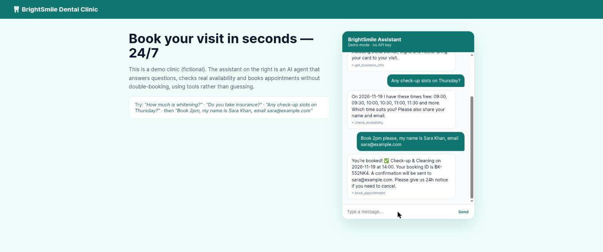

# AI Booking Agent: answers questions and books appointments 24/7

An AI receptionist for clinics, salons, agencies and consultants. It answers customer questions, checks **real availability**, and **books, confirms and cancels appointments** using tool calls, so it never invents a time slot or double-books.

> Open-source demo project by [Saad Rupai](https://github.com/saadrupai), a backend engineer who builds AI agents, chatbots and automations.



## Features

- **Real AI agent with tool calling.** The model can only act through four validated tools: `get_business_info`, `check_availability`, `book_appointment` and `cancel_appointment`.
- **No double-booking.** Overlapping appointments are rejected, slots respect opening hours, service length and 1-hour minimum notice.
- **Safe by design.** Cancelling needs the booking ID *and* the email; tool errors go back to the model so it can recover and ask again; there's a hard limit on agent steps and per-IP rate limiting.
- **Claude or OpenAI** (or any OpenAI-compatible API such as OpenRouter or Groq).
- **Demo mode with no API key.** A small rule-based engine speaks the same tool protocol, so you can try it for free. It's clearly labelled as not being AI.
- **Configure your business in JSON:** services, prices, durations, opening hours, timezone and FAQ.
- **Zero dependencies.** Plain Node 22 and TypeScript, with an admin API for listing bookings.

## Quick start

```bash
node src/server.ts                 # demo mode, no key needed → http://localhost:8787
ANTHROPIC_API_KEY=... node src/server.ts   # real AI (or OPENAI_API_KEY=...)
```

Try it: *"How much is whitening?"*, then *"Any check-up slots on Thursday?"*, then *"Book 2pm, my name is Sara Khan, email sara@example.com"*.

## Make it yours

Edit `config/business.json`:

```json
{
  "name": "Your Business",
  "utcOffsetMinutes": -300,
  "hours": { "mon": ["09:00", "17:00"], "sat": null },
  "services": [{ "id": "consult", "name": "Consultation", "minutes": 30, "price": "$50" }],
  "faq": [{ "q": "parking", "a": "Free parking behind the building." }]
}
```

## API

| Endpoint | Purpose |
|---|---|
| `POST /api/chat` | `{message, sessionId?}` → `{reply, sessionId, toolsUsed[]}` |
| `GET /api/bookings` | List confirmed bookings (header `X-Admin-Key`) |
| `GET /api/health` | Status and active LLM |

## How it works

```
customer message → agent loop ──► LLM decides: answer, or call a tool
                        ▲              │
                        └── tool result ┘   (check_availability / book / cancel run real code,
                                             validated, persisted; max 6 steps)
```

## Tests

```bash
npm test
```

There are 10 tests covering opening hours, service length, minimum notice, double-booking prevention, cancel authorization, persistence, tool error recovery, the agent loop and its step limit, a full end-to-end booking conversation and the HTTP API.

## Deploy

```bash
docker build -t booking-agent . && docker run -p 8787:8787 -e ANTHROPIC_API_KEY=... -e ADMIN_KEY=... -v bookings:/data booking-agent
```

**Production notes:** this demo uses a fixed UTC offset (no automatic daylight-saving changes) and a JSON file store. For production I'd connect Google Calendar or Calendly, Postgres, and email/SMS confirmations, and embed the chat on your website or WhatsApp.

## Want an AI booking agent for your business?

I build custom AI agents connected to your calendar, CRM, website and WhatsApp. You can reach me on [Fiverr](https://www.fiverr.com/saadrupai69).

MIT License
